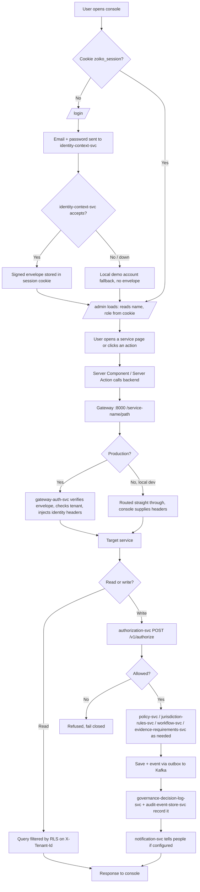

# ZoikoSuite: agenda, user journey and what every service does

**Written:** 27 October 2026 · **Repo:** `zoiko-suite-backend/` (Go microservices) and
`zoiko-suite-frontend-platform/` (Next.js admin console)

## How to use this document

This is a briefing for a person or an AI model that has to understand ZoikoSuite and explain it
to others. Read it top to bottom once. After that, each section stands on its own.

- Sections 1–6 cover what the product is, why it exists and who uses it.
- Sections 7–10 cover how a request travels through the system, step by step.
- Sections 11–13 explain the 16 core services of Domain 1 and Domain 2 in detail.
- Section 14 is a catalogue of all 121 services, each with a plain example.
- Sections 15–17 hold corrections, key files and a glossary.

**How much to trust each statement.** Everything in sections 1–13 was read from the repo
(architecture docs, service READMEs, OpenAPI specs, package comments, frontend code). In the
catalogue (section 14), the **Src** column says where each description came from:

- **S**: read from that service's own spec, README, package comment or `SPEC_DEVIATIONS.md`.
- **N**: inferred from the service name only. Check the service's code or docs before relying on it.

Nothing here was tested against running services. Endpoints are the ones the repo declares.

---

## 1. The motto: what ZoikoSuite is

**Primary objective** (from `docs/architecture/01-backend.md`):

> Ensure every financial, workforce, legal, tax, and compliance action executes inside a
> governed, evidential, jurisdiction-aware control layer.

**Category it claims:** *Governed Business Operations Intelligence.*

**It is not an ERP.** The architecture doc makes this point directly. A normal enterprise system
works like this:

```
Input → Transaction Processing → Storage → Reporting
```

ZoikoSuite works like this:

```
Intent → Policy Validation → Jurisdiction Validation → Execution → Evidence Capture → Intelligence
```

**The core rule:** governance is not a later step, a report, or an audit layer added on top. It is
the *execution boundary*. No material business action completes until the platform has answered:

1. Who is acting, and under what delegated authority?
2. Under which tenant, legal entity and jurisdiction is it happening?
3. Which policy, approval path and control thresholds apply?
4. Which legal, tax, payroll and compliance effects does it trigger?
5. What evidence must be recorded at the moment it executes?

**One-line summary:** governance first, evidence created automatically, audit becomes easy.

---

## 2. Why it is being built

- **Typical software adds governance later.** Most enterprise tools record the transaction first
  and check compliance afterwards (audits, reviews). By then, money may already have moved.
  ZoikoSuite checks before the action and records proof during the action.
- **Audit readiness becomes a by-product.** Evidence is produced as work happens, so audits do not
  need a separate effort to rebuild what happened.
- **Multi-country, multi-company businesses need one control layer.** Finance, HR, payroll, tax,
  legal and compliance rules vary by country. ZoikoSuite applies them in one place instead of
  across separate tools.
- **Lower compliance risk.** No action proceeds without policy, approval, jurisdiction check and
  evidence.
- **Safe AI.** AI may recommend, classify, detect and forecast. It may never bypass policy or
  approval.
- **Build order is foundation first.** Identity, entity, governance, evidence and security are
  built before business domains are scaled (`docs/architecture/06-blueprint.md`: "No
  business-domain expansion may outrun identity, entity, governance, evidence, and security
  foundations").

---

## 3. Who uses it: an organisation, not a single person

ZoikoSuite is built for **organisations**, not for solo use.

- **Multi-tenant:** a *tenant* is one customer organisation. Many organisations share the
  platform, and each one's data is isolated from the others.
- **Multi-entity:** one tenant can hold many *legal entities* (e.g. Acme India, Acme Germany).
- **Multi-jurisdiction:** each entity is tied to a country or region whose rules apply.
- **Role-based:** many people in one organisation use it together, each with their own role.
- **Deployment options:** shared SaaS, or a dedicated database or deployment for regulated
  enterprise customers.

**User groups** (taken from the architecture docs and service names):

| Who | What they do in ZoikoSuite |
|---|---|
| Employees and managers | Submit and approve requests: leave, expenses, purchases |
| Finance teams and controllers | Ledger, month-end close, payments, reconciliation |
| Procurement teams | Purchase requests, purchase orders, supplier onboarding |
| Suppliers | Are paid, checked, onboarded; their bank details are verified |
| HR and payroll teams | Employee records, contracts, payroll runs, benefits |
| Tax teams | Tax calculation, VAT/GST, filings |
| Legal and compliance officers | Contracts, obligations, policies, privacy |
| Treasury | Cash, banking, payment runs |
| Board and executives | Board resolutions, high-value approvals, delegated authority |
| Auditors and regulators | Read evidence trails and decision logs |
| Platform administrators | Run the admin console: roles, flags, secrets, tenants |
| Integration partners | Banks, HR systems, e-signature, tax authorities, via connector services |

---

## 4. The ten design principles (the "agendas")

From `docs/architecture/01-backend.md` §02:

1. **Governance before execution.** Every material operation passes policy, authorization,
   approval and jurisdiction checks first. There is no bypass path.
2. **Evidence by default.** The platform produces unalterable evidence as work happens.
3. **Entity-aware everywhere.** Every action, record, rule and event belongs to a legal entity.
4. **Jurisdiction is first-class.** Country rules drive tax, payroll, employment law, filings,
   retention and approvals at runtime. Jurisdiction is not just a settings field.
5. **Modular capability, unified control.** Business modules can be switched on separately.
   Governance, identity, evidence and observability are always on.
6. **API-first, UI-second.** The UI is only a client of governed services, never a privileged
   shortcut.
7. **AI is policy-constrained.** AI may recommend; it may never override policy or approval.
8. **Multi-tenant, isolatable.** Shared infrastructure, with isolation strong enough for
   regulated customers.
9. **Source truth stays intact.** Analytics and reports never change the original records.
10. **No silent state change.** Every material change must be attributable, evidenced and
    reproducible. Silent overwrites are forbidden.

---

## 5. The seven planes (layers of the architecture)

From `docs/architecture/01-backend.md` §03. Each plane has one job and none is optional.

| Plane | Job | Example services |
|---|---|---|
| Experience | Where users and systems interact: web app, admin console, APIs, notifications | `zoiko-suite-frontend-platform`, notification-svc |
| Domain Execution | Runs the business: finance, HR, payroll, tax, legal, commercial | general-ledger-svc, payroll-run-svc, contract-lifecycle-svc |
| Governance | The non-bypassable control layer: policy, authorization, approvals, jurisdiction | policy-svc, authorization-svc, workflow-svc, jurisdiction-rules-svc |
| Evidence | Audit trails, decision records, document history | governance-decision-log-svc, audit-event-store-svc, evidence-manifest-svc |
| Intelligence | Forecasts, anomaly detection, risk scores; never changes source records | forecasting-svc, anomaly-detection-svc, compliance-risk-scoring-svc |
| Data | Databases, event streams (Kafka), document stores, search | Postgres per service, Kafka, search-indexer-svc |
| Security and Infrastructure | Identity, access, encryption, secrets, networking, deployment | identity-context-svc, gateway-auth-svc, secret-vault-integration-svc, mtls-management-svc |

**Service classes** (`docs/architecture/03-microservices.md`):

| Class | Purpose |
|---|---|
| Governance Platform Services | Shared, non-bypassable control services (the "core moat") |
| Core Domain Services | Finance, payroll, HR, legal, tax, compliance, commercial work |
| Evidence & Audit Services | Audit records, document lineage, workflow history, evidence packs |
| Platform Foundation Services | Identity, tenant/entity context, secrets, configuration, notifications, search |
| Intelligence & Reporting Services | Risk scoring, anomaly detection, forecasting, reporting |
| Integration & Extensibility Services | Safe connections to banks, ERPs, HR systems, filing portals, e-signature |

---

## 6. The canonical runtime control flow

From `docs/architecture/01-backend.md` §04. This is the model for every material action
(payroll release, contract signing, tax filing, board resolution, payment, termination, …).

| Stage | What happens |
|---|---|
| 1. Request intake | A request arrives from UI, API, schedule or event. Every entry path is governed. |
| 2. Identity resolution | Who is acting, which tenant, entity, jurisdiction, role, delegated authority, session trust. |
| 3. Governance evaluation | Policy thresholds, segregation of duties (SoD), approval matrix, jurisdiction obligations, required documents. |
| 4. Execution authorization | Allowed → continue. Not allowed → denied, escalated, or turned into an approval workflow. Silent failure is forbidden. |
| 5. Transaction and event commit | The domain service saves the change and publishes an append-only event. Events are facts, not commands. |
| 6. Evidence generation | Actor, action, entity, jurisdiction, rule applied, approvals, documents, timestamps and provenance are recorded. |
| 7. Intelligence update | Analytics, forecasting and risk services read the events and update insights without changing source records. |

---

## 7. Governance first vs audit first: one worked example

**Scenario.** A clerk wants to pay a supplier 500,000. The company rule says: above 100,000, two
approvers are needed. (The 100,000 / two-approver rule is an illustration, not real policy data
from the repo. Rules like it are stored in policy-svc as `APPROVAL_THRESHOLD` policies.)

### ZoikoSuite: governance first, audit later

1. The clerk submits the payment in the console.
2. **Identity:** the platform confirms who the clerk is, their legal entity and their delegated
   authority (identity-context-svc).
3. **Policy:** policy-svc evaluates the threshold rule: above 100,000 needs two approvers.
4. **Jurisdiction:** the country's rules are applied, e.g. withholding tax or a filing duty
   (jurisdiction-rules-svc).
5. **Authorization:** authorization-svc checks segregation of duties. The clerk cannot approve
   their own payment.
6. **Result:** the payment is **not** released. It becomes an approval workflow waiting for a
   second approver (workflow-svc). No money has moved.
7. The second approver approves. Only now does the payment execute.
8. **Evidence:** who requested, who approved, which rule applied, the amount and the time are
   recorded in the same step (governance-decision-log-svc, audit-event-store-svc).
9. **Later, the auditor** finds a complete record and does not need to rebuild anything.

### Typical outside system: audit first, governance second

1. The clerk pays the invoice directly.
2. Money leaves the bank.
3. Months later, an auditor reviews a sample of payments.
4. The auditor finds that the 500,000 payment had only one approver, against policy.
5. **Result:** the breach has already happened. Money is hard to recall. The company now has an
   audit finding, remediation work, and possibly penalties.

### The difference

| | ZoikoSuite (governance first) | Typical system (audit first) |
|---|---|---|
| When the rule is checked | Before the action | Months after the action |
| Who enforces it | The system, with no bypass | People reviewing afterwards |
| Cost of a mistake | Prevented | Only reported |
| Evidence | Created automatically with every action | Collected later, often incomplete |
| Coverage | 100% of actions | A sample |

---

## 8. The user journey through the system

This is what happens, in order, when a person uses the admin console. File paths point to the
code that does each step.

### Phase A: log in (once per 8 hours)

1. The user opens the console. `proxy.ts` (frontend) looks for the session cookie
   `zoiko_session`. With no cookie, the user is redirected to `/login?redirect=<page>`.
2. The user enters email and password. `app/api/auth/login/route.ts` sends them to
   **identity-context-svc**, which authenticates the user and then resolves their context
   (`/v1/context/resolve`). It returns a **signed IdentityContextEnvelope** (a JWT) that carries
   principal, tenant and legal entity.
3. The console stores the session in the `zoiko_session` cookie for 8 hours
   (`SESSION_MAX_AGE_SECONDS` in `lib/auth.ts`). The envelope itself expires in minutes.
4. **Fallback:** if identity-context-svc is down, or does not know the account, the console falls
   back to local demo accounts in `lib/auth.ts`. That session has **no envelope**. The login
   response says which path was used (`identityProvider`: `identity-context-svc` or
   `local-credentials`).

### Phase B: open the admin page

5. The user opens `/admin`. `app/admin/layout.tsx` reads the cookie for name, email and role.
6. **Only the login cookie is checked here.** authorization-svc is **not** called just to show
   the page.
7. In development, `proxy.ts` can also start the backend services the page needs (on-demand
   launcher, `lib/servicectl`).

### Phase C: open a service page or perform an action

8. The page fetches data **from the server side** (Server Component or Server Action), never
   from the browser. Two reasons: the Go services have no CORS, and backend hostnames and
   identity headers must stay hidden from the browser.
9. The request goes to the **single gateway port** (Traefik, `localhost:8000`):
   `http://localhost:8000/<service-name>/<service's own path>`,
   e.g. `/purchase-order-svc/v1/purchase-orders`. With `ZOIKO_USE_GATEWAY=false`, the console
   calls each service's own port instead.
10. **Gateway check:**
    - **Production:** Traefik's ForwardAuth sends every request first to **gateway-auth-svc**
      (port 8092). It verifies the signed envelope against identity-context-svc's public keys
      (JWKS), checks tenant and entity against tenant-entity-registry-svc, consults carta-svc
      for risk, and injects trusted headers: `X-Principal-Id`, `X-Tenant-Id`,
      `X-Legal-Entity-Id`. Forged or missing identity → the request is refused.
    - **Local development:** the gateway routes in
      `deployments/traefik-dynamic/all-services.yml` carry **no** auth check ("LOCAL DEVELOPMENT
      ONLY … must never be deployed"). The console sends the identity headers itself.
11. **The service receives the request** and reads who the user is from those headers. The IDs
    are UUIDs. A non-UUID value fails inside the Postgres driver and shows up as **503**, not 400.
12. **Read (viewing data):** the database's row-level security (RLS) returns only rows for the
    user's tenant. A read without `X-Tenant-Id` returns 404 or an empty list instead of failing
    loudly.
13. **Write (create, approve, pay):** before saving, the service calls **authorization-svc**
    `POST /v1/authorize`: "may this principal do this action, on this entity, now?" If
    authorization-svc is unreachable, the service refuses (fails closed).
14. **Further governance checks** depending on the action: policy-svc (thresholds, approval
    rules), jurisdiction-rules-svc (country rules), workflow-svc (multi-step approval),
    evidence-requirements-svc (proof needed before completion). The order is decided by each
    service's code; it is not one fixed chain.
15. **Commit:** the service saves the change and writes an event through its transactional outbox
    (same database transaction), which publishes it to Kafka.
16. **Evidence:** governance-decision-log-svc stores the decision and why it was allowed.
    audit-event-store-svc stores the stream of events (what happened, in order).
17. **Notification:** notification-svc sends messages for events that have a notification
    configured, e.g. "Payment P-101 needs your approval". Not every action sends one.

### Flowchart



### The three checks in one line each

- **Login cookie:** are you logged in?
- **Gateway + gateway-auth-svc:** is this request genuine, and who sent it?
- **Service + authorization-svc:** are you allowed to change this?

### Common misunderstandings (corrected during the session)

| Misunderstanding | What the code actually does |
|---|---|
| "`/admin` is checked by authorization-svc" | `/admin` checks only the session cookie. authorization-svc is called by backend services before writes. |
| "The gateway decides read / write / no-view" | The gateway (gateway-auth-svc) only proves the request is genuine and attaches identity headers. Read scoping is done by database RLS; write permission by authorization-svc. |
| "`zoiko_session` is a token the user types" | It is a cookie the console sets after login. It holds the session and, when available, the signed envelope. |
| "Policy and jurisdiction always run after authorization in a fixed order" | Each service decides its own order. Some check jurisdiction before authorization. |
| "Every action sends a notification" | Only events that have a configured notification do. |

---

## 9. The two record keepers: decision log vs audit event store

Both are part of the Evidence plane, but they answer different questions.

| | governance-decision-log-svc (port 8083) | audit-event-store-svc (port 8084) |
|---|---|---|
| Question it answers | **Why** was this allowed? | **What** happened, and in what order? |
| What it stores | Governance decisions: verdict, rule applied, approvers, time | Every event published on Kafka |
| How data arrives | Services call `POST /v1/decisions` | It consumes Kafka topics (bad messages go to `<topic>.dlq`) |
| Can it be changed? | No, append-only and tenant-owned | Append-only history |
| Does it decide anything? | No. Policy, authorization and workflow decide; it only records | No |

**Example.** Payment P-101 for 500,000 needs two approvers.

- 10:01, Anna approves → audit-event-store-svc records `payment.approval.recorded` by Anna.
- 10:02, Ben approves; the rule is now satisfied →
  - governance-decision-log-svc records: *"P-101 APPROVED. Rule DUAL-APPROVAL-100K.
    Approvers: Anna, Ben. 10:02."*
  - audit-event-store-svc records `payment.approved` at 10:02.
- 10:03, payment sent → audit-event-store-svc records `payment.released`.

"Why was P-101 paid?" → the decision log. "What happened to P-101, step by step?" → the audit
event store. (Event names above are illustrations.)

---

## 10. Who sets the rules, and obligations vs workflow

### Rules live in policy-svc

policy-svc (port 8085) stores policies and policy versions, including `APPROVAL_THRESHOLD`
rules, and evaluates them at `POST /v1/policies/evaluate`. A person with the right permission
creates or changes a rule through the policy-svc API or the admin console. Services then call it
to decide whether, for example, one approval is enough.

### Obligations vs workflow

| | obligations-svc (port 8088) | workflow-svc (port 8090) |
|---|---|---|
| What it is | A list of duties that must be done by a deadline | The approval engine that routes an item through sign-off steps |
| What it tracks | The duty, its state (open, done, overdue), due date, legal entity, linked workflow | Who has signed off so far, and who is next |
| Rule | Jurisdiction-bound; validated against jurisdiction-rules-svc, fail closed | Extends authorization, never replaces it: each approver must still be allowed |
| Example | "File the VAT return for Acme Germany by 31 January" | "Payment goes Clerk → Manager → Director" |

**Together:** the VAT return is an obligation. Filing it needs approval, so a workflow runs before
the obligation is marked done.

Note: obligation-tracking-svc (port 8121, a teammate's service) overlaps with obligations-svc.
The 23 Oct plan decided obligations-svc is the owner of obligations.

---

## 11. How to reach any service (development)

- **Through the gateway:** `http://localhost:8000/<service-name>/<path>`
  (port set by `GATEWAY_PORT`; prefixes are the full service name, generated into
  `deployments/traefik-dynamic/all-services.yml`; index in `deployments/traefik-dynamic/ROUTES.md`).
- **Direct:** `http://localhost:<port>/<path>`. Useful when the gateway itself is suspect.
- **Health:** `/healthz` or `/health`, depending on the service.
- **A wrong prefix** gives a Traefik 404 that looks exactly like the service being down.
- **Start only what you need:** `docker compose -f deployments/docker-compose.yml up -d --build <svc>`.
  Do not start the whole ~90-service file.
- **Identity headers** on every call: `X-Principal-Id`, `X-Tenant-Id`, `X-Legal-Entity-Id`
  (UUIDs). In production gateway-auth-svc sets them; local routes trust what the caller sends.

---

## 12. Domain 1: Identity, Scope & Foundation (9 services)

Source: `docs/audit_files/Identity, Scope & Foundation-audit-2026-09-23.md` (Group 1) and each
service's spec. These services answer "who are you, which organisation are you in, and what is
switched on?"

### 12.1 identity-context-svc · port 8080
- **Does:** resolves the authenticated principal, tenant, active legal entity, role profile,
  delegated authority and session trust for every request. Issues and verifies the signed
  identity tokens (envelopes). Has MFA, OIDC and federation packages.
- **Access:** `localhost:8000/identity-context-svc/...`; e.g. `/v1/context/resolve`,
  `/v1/context/session/{id}`.
- **Used when:** at login, and whenever any request needs to know who the user is.
- **Example:** Ravi logs in. The service confirms: Ravi, tenant Acme, entity Acme India, role
  "AP Clerk", and hands back a signed envelope.

### 12.2 tenant-entity-registry-svc · port 8081
- **Does:** master register of tenants, legal entities, entity hierarchies, jurisdiction
  assignments, data-residency policies and residency regions. Uses Postgres row-level security
  for tenant isolation.
- **Access:** `localhost:8000/tenant-entity-registry-svc/...`
- **Used when:** a company or legal entity is created or changed; when gateway-auth-svc checks
  that a tenant may transact and that the entity in the token belongs to it.
- **Example:** Acme adds "Acme Germany" under Acme Group and assigns it the Germany jurisdiction.

### 12.3 configuration-feature-flag-svc · port 8086
- **Does:** versioned runtime configuration and environment-aware feature flags.
- **Access:** `localhost:8000/configuration-feature-flag-svc/v1/config`, `/v1/flags`
- **Used when:** a feature is turned on or off, or a setting changes.
- **Example:** the "new invoice screen" flag is on for the test tenant only.

### 12.4 secret-vault-integration-svc · port 8087
- **Does:** policy-gated broker for secrets. Workloads never hold long-lived credentials; they
  ask this service, which grants a short lease and supports rotation. Version 1 uses a local
  encrypted-file backend; a real Vault/KMS client is pending.
- **Access:** `localhost:8000/secret-vault-integration-svc/v1/secrets/broker`
- **Used when:** a service needs a database or API secret at runtime.
- **Example:** the payment service asks for its bank API key and gets it for one hour only.

### 12.5 gateway-auth-svc · port 8092
- **Does:** Traefik's ForwardAuth target. Every gated request is sent here first; a 2xx lets it
  through, anything else is returned to the caller. Verifies the signed envelope against
  identity-context-svc's JWKS, resolves tenant context via tenant-entity-registry-svc, consults
  carta-svc (risk) and siem-integration-svc (security events), and strips forged identity
  headers.
- **Access:** called by Traefik, not by users. Direct: `localhost:8092`.
- **Used when:** on every production request, before it reaches any service.
- **Example:** a request that sets its own `X-Tenant-Id` to another company's ID is stopped here.

### 12.6 search-indexer-svc · port 8096
- **Does:** builds and maintains the enterprise search index (spec ESR-01…05). Before showing a
  result it confirms through authorization-svc that the user may see it.
- **Access:** `localhost:8000/search-indexer-svc/...`
- **Used when:** data changes (index update) and when someone searches.
- **Example:** a new supplier record becomes searchable, but only for users allowed to see it.

### 12.7 notification-svc · port 8133
- **Does:** notification and communication delivery (spec NCD-01…05). Tracks real delivery
  states (`CREATED`, `SUBMITTED_TO_PROVIDER`, `PROVIDER_ACCEPTED`, …); it never reports a
  generic "sent". Checks authorization-svc and fails closed.
- **Access:** `localhost:8000/notification-svc/...`
- **Used when:** an event needs to tell a person something.
- **Example:** "Payment P-101 needs your approval" sent to Ben.

### 12.8 delegated-authority-svc · port 8136
- **Does:** time-bound, scope-bound delegated authority chains. authorization-svc intersects a
  delegation with the delegator's live grants, so a delegate can never exceed the delegator.
- **Access:** `localhost:8000/delegated-authority-svc/...`
- **Used when:** someone is away and another person must approve for them.
- **Example:** Priya delegates her approvals to Ben for three days, up to 50,000 each.

### 12.9 access-control-svc · port 8137
- **Does:** role catalogues and permission bundles, and provisions them into authorization-svc.
  Runs access reviews (periodic checks of who holds which role). Every action a handler checks
  must be registered here as a permission definition, or it can never be granted.
- **Access:** `localhost:8000/access-control-svc/...`
- **Used when:** admins create roles, assign roles, or run access reviews.
- **Example:** create the role "Payment Approver" with the payment-approve permission and assign
  it to Ben for Acme Germany.

---

## 13. Domain 2: Governance Platform, "the non-bypassable spine" (7 services)

Source: `docs/audit_files/Governance Platform-audit-2026-09-28.md` (Group 2) and each service's
spec. These services answer "is this allowed, under which rules, who must approve, and what proof
is needed?"

### 13.1 jurisdiction-rules-svc · port 8082
- **Does:** the authoritative registry of jurisdictions and their effective-dated rules.
  `/rule-pack` resolves a jurisdiction's whole parent chain to one winning rule per rule code and
  names where it came from. `GET /v1/jurisdictions/{id}` is the fail-closed check other services
  make before saving a `jurisdiction_id`: **503 means "cannot answer", never "no"**. Also tracks
  legal drift (`legal.drift.detected`). Nothing is deleted: rules are end-dated, so past dates
  still answer correctly. Reads are public; writes need authorization-svc.
- **Access:** `localhost:8000/jurisdiction-rules-svc/v1/jurisdictions`, `/v1/rules`,
  `POST /v1/validate-action`, `POST /v1/regulatory-calculations:execute`
- **Used when:** an action depends on a country's rules, or a jurisdiction ID is saved.
- **Example:** a German invoice is checked against the German VAT rule valid on the invoice date.

### 13.2 governance-decision-log-svc · port 8083
- **Does:** the append-only ledger of governance decisions. Every decision is tenant-owned,
  immutable once written, and queryable by actor and other fields. It records decisions; it does
  not make them. A "Tier 0, platform survival" service.
- **Access:** `POST` / `GET localhost:8000/governance-decision-log-svc/v1/decisions`
- **Used when:** policy, authorization or workflow reaches a decision.
- **Example:** "Payment P-101 APPROVED under rule X by Anna and Ben at 10:02."

### 13.3 policy-svc · port 8085
- **Does:** stores policies and policy versions, and evaluates them (e.g. `APPROVAL_THRESHOLD`).
  Policies carry a `jurisdiction_context`.
- **Access:** `localhost:8000/policy-svc/v1/policies`, `POST /v1/policies/evaluate`
- **Used when:** an action may need approval or must respect a limit.
- **Example:** "Above 100,000 needs two approvers" is evaluated for a 500,000 payment.

### 13.4 obligations-svc · port 8088
- **Does:** owns obligation definitions, obligation state, due dates, and links from an
  obligation to its entity and its workflow. Jurisdiction-bound, with fail-closed validation
  against jurisdiction-rules-svc.
- **Access:** `localhost:8000/obligations-svc/v1/obligations`
- **Used when:** a legal or filing duty is created, changes state, or falls due.
- **Example:** "VAT return for Acme Germany, due 31 January", open until filed.

### 13.5 authorization-svc · port 8089
- **Does:** the runtime access-decision engine (policy decision point). `POST /v1/authorize`
  evaluates six layers in order, and every layer after the first can only **remove** what an
  earlier one allowed. Layer 0: principal status (a suspended or disabled user can do nothing).
  Layer 1: role-based access (roles → permission bundles → effective-dated, entity-scoped
  assignments). Layer 2: delegated authority, intersected with the delegator's live grants.
  Layer 3: static segregation of duties (conflicting roles). Layer 4: own-object segregation of
  duties (you cannot approve your own request). Layer 5: attribute-based rules (ABAC). Also holds
  authority limits and break-glass approvals.
- **Access:** `POST localhost:8000/authorization-svc/v1/authorize`
- **Used when:** before every material write, called by the service doing the write.
- **Example:** clerk Ravi tries to approve his own payment → DENY (segregation of duties).

### 13.6 workflow-svc · port 8090
- **Does:** approval workflows that extend authorization and never replace it. Routes an item
  through approval steps and records each one.
- **Access:** `localhost:8000/workflow-svc/...`
- **Used when:** an item needs more than one sign-off.
- **Example:** a payment goes Clerk → Manager → Director; each step waits for the right person.

### 13.7 evidence-requirements-svc · port 8130
- **Does:** decides what evidence must exist before an action may complete, and records each
  decision in an append-only ledger.
- **Access:** `localhost:8000/evidence-requirements-svc/v1/...`
- **Used when:** an action is about to complete and proof is required first.
- **Example:** "The payment cannot be released until the invoice PDF is attached."

### 13.8 One payment through both domains

1. **identity-context-svc:** who is Ravi? (Domain 1)
2. **gateway-auth-svc:** is the request genuine? (Domain 1)
3. **jurisdiction-rules-svc:** which German rule applies? (Domain 2)
4. **policy-svc:** two approvers needed. (Domain 2)
5. **authorization-svc:** may Ravi do this? ALLOW or DENY. (Domain 2)
6. **workflow-svc:** route to the second approver. (Domain 2)
7. **evidence-requirements-svc:** is the invoice attached? (Domain 2)
8. **governance-decision-log-svc:** record the decision. (Domain 2)
9. **notification-svc:** tell the next approver. (Domain 1)

---

## 14. Catalogue of all 121 services

The `services/` folder has 126 folders. Five are not services:

- `eventing`, `identity-envelope`, `search-client`: shared Go libraries every service imports
  (event publishing, the signed identity envelope and the API contract helpers, search client).
- `_certification`: tool that runs the cited tests and writes a release certificate.
- `_contract`: shared contract artefacts.

**How to read the table.** "Kid example" explains the service as you would to a five-year-old,
with the software term in brackets. Port is from `deployments/traefik-dynamic/ROUTES.md`; "—"
means the service is not in the gateway route index. Src: **S** = read from the service's own
docs or code, **N** = inferred from the name.

### 14.1 Front door, identity and security

| Service | Port | What it does | Kid example | Used when | Src |
|---|---|---|---|---|---|
| identity-context-svc | 8080 | Resolves who you are, your tenant, entity, roles; issues signed envelopes | The school register with your name and class (identity provider) | Login, every request | S |
| gateway-auth-svc | 8092 | Verifies every request's signed envelope before Traefik forwards it | The gate guard checking your ticket (ForwardAuth) | Every production request | S |
| authorization-svc | 8089 | Decides "may this person do this, here, now?" | The teacher saying yes or no to a hall pass (policy decision point) | Before every write | S |
| access-control-svc | 8137 | Defines roles and permission bundles, loads them into authorization-svc, runs access reviews | The list of which kids may use which room (RBAC catalogue) | Role created or assigned | S |
| delegated-authority-svc | 8136 | Time- and scope-limited delegation of authority | "Priya signs for me this week" (delegation chain) | Someone is away | S |
| tenant-entity-registry-svc | 8081 | Tenants, legal entities, hierarchies, jurisdictions, data residency | The school board's list of schools (master registry) | Company created or checked | S |
| configuration-feature-flag-svc | 8086 | Versioned settings and feature flags | A light switch for a new feature (feature flag) | Feature turned on/off | S |
| secret-vault-integration-svc | 8087 | Leases secrets to allowed workloads, rotation-aware | A locker that gives a key for one hour (secret broker) | A service needs a password | S |
| mtls-management-svc | 8140 | Internal certificate authority for service-to-service mTLS, incl. revocation | Every school bus carries a registered pass (certificate authority) | Services connect securely | S |
| key-management-svc | — | Key records and metadata; today it does not encrypt or decrypt itself (key custody is planned work, SEC-1) | A logbook of which key opens which lock (key registry) | Keys created, rotated, listed | S |
| carta-svc | 8142 | Continuous Adaptive Risk and Trust Assessment: answers `ALLOW`, `STEP_UP_MFA`, `ISOLATE` or `DENY` for a request | A guard who asks for a second ID when something looks odd (risk-based access) | gateway-auth-svc checks a request | S |
| siem-integration-svc | 8141* | Sends security events to a security monitoring system (SIEM) | A camera feed to the guard room (security event forwarding) | Security-relevant event happens | N |
| kill-switch-registry-svc | 8147 | Privileged, approval-controlled, logged emergency stops scoped by plane, domain, provider or tenant | A fire alarm that stops the lift (kill switch) | Something must be stopped fast | S |

\* 8141 is from `deployments/docker-compose.yml`, not the gateway index.

### 14.2 Governance and rules

| Service | Port | What it does | Kid example | Used when | Src |
|---|---|---|---|---|---|
| policy-svc | 8085 | Stores policies and evaluates them (e.g. approval thresholds) | "Over 100, two teachers must sign" (rules engine) | An action needs a rule check | S |
| jurisdiction-rules-svc | 8082 | Jurisdictions and their effective-dated rules | Each country's rule book (rule registry) | Country rules matter | S |
| workflow-svc | 8090 | Multi-step approval workflows | A form passed from teacher to principal (workflow engine) | Several sign-offs needed | S |
| obligations-svc | 8088 | Duties with due dates, tied to entity and jurisdiction | A homework list with deadlines (obligation register) | A duty is created or due | S |
| evidence-requirements-svc | 8130 | Decides what proof must exist before an action completes | "Bring your signed slip before the trip" (evidence gate) | An action is about to finish | S |
| governance-decision-log-svc | 8083 | Append-only record of governance decisions | A diary of who said yes to what (decision ledger) | A decision is made | S |
| schema-registry-svc | 8093 | Canonical registry of event message formats | A form template every message must follow (schema registry) | Services publish or read events | S |
| retention-registry-svc | 8148 | How long records are kept; planned owner of legal holds (GOV-09/10) | "Keep tax papers 7 years" (retention policy) | Records reviewed for keep/delete | N |
| capability-registry-svc | 8145 | Capability, module and release registry: whether a capability exists, is released and is available | The shop menu showing which dishes are ready (capability catalogue) | A module is checked or released | S |
| commercial-account-svc | 8144 | The verified customer that buys ZoikoSuite, its users, subscriptions and renewals | A gym membership card that renews (subscription/account) | A customer signs up or renews | S |
| source-authority-svc | 8150 | Says which connected system's value to trust for a field, without guessing when sources disagree | "For your address, trust the school office" (source of truth) | Two systems disagree | S |

### 14.3 Evidence, audit and records

| Service | Port | What it does | Kid example | Used when | Src |
|---|---|---|---|---|---|
| audit-event-store-svc | 8084 | Consumes Kafka events and keeps the history; dead-letters bad messages | A CCTV log of who did what, when (event store) | Any event is published | S |
| evidence-manifest-svc | 8095 | Assembles evidence sets from decision log, authorization and workflow for audits; fails whole, never partial | A folder labelled "Audit file for P-101" (evidence bundle) | An auditor or regulator asks | S |
| document-vault-svc | 8094 | Secure document storage with authorization checks | A fireproof safe for papers (document store) | A document is stored or fetched | S |
| workflow-history-svc | 8097 | History of approval steps | A diary of who signed which page (audit trail) | Someone asks how an approval went | N |
| comments-collaboration-svc | — | Comments and collaboration on business records (BIZ-09) | Sticky notes on a worksheet (comments) | Someone comments on an item | S |
| migration-integrity-svc | — | Checks records being moved in from old systems (required fields, duplicates, number formats) and keeps an audit trail; customer data cutover, not database migrations | Checking every box before moving house (data migration validation) | A customer migrates data in | S |
| global-search-svc | — | Search across the platform | Google for your own company (search) | Someone searches | N |

### 14.4 Reference data

| Service | Port | What it does | Kid example | Used when | Src |
|---|---|---|---|---|---|
| currency-registry-svc | — | ISO 4217 currencies, minor units, support lifecycle (REF-02) | A chart saying 1 dollar = 100 cents (reference data) | Money is entered or shown | S |
| fiscal-calendar-svc | — | Entity-specific financial calendars (REF-04) | A calendar where the year starts in April (fiscal calendar) | Financial periods are set | S |
| accounting-period-svc | — | Period instances, period state and the posting gate (REF-05) | A locked diary for last month (period close) | A month is opened or closed | S |
| org-structure-svc | 8116 | Organisation units and reporting lines | A family tree of managers (org chart) | Reporting lines change | N |
| counterparty-management-svc | 8124 | Records of business partners | An address book of companies (party master) | A partner is added | N |

### 14.5 Finance: record to report

| Service | Port | What it does | Kid example | Used when | Src |
|---|---|---|---|---|---|
| general-ledger-svc | 8098 | The main accounting book | The shop's master notebook (ledger) | Any money posting | N |
| accounts-payable-svc | 8099 | Money the company owes suppliers | "I owe Ram 500" (payables) | Supplier bill entered | N |
| accounts-receivable-svc | 8101 | Money customers owe; includes the customer financial profile (AR-01) | "Customer X owes us 300" (receivables) | Customer invoiced | S |
| financial-close-svc | 8104 | Steps to close a month or year | The end-of-month checklist (close management) | Period close | N |
| consolidation-svc | 8106 | Adds many companies into one group result | Adding all branches into one total (consolidation) | Group reports | N |
| intercompany-accounting-svc | 8105 | Transactions between companies in one group (ACC-11) | One sibling lending pocket money to another (intercompany) | Group companies trade | S |
| financial-statements-svc | — | Profit and loss, balance sheet (REP-01) | A money report card (financial statements) | Reports produced | S |
| financial-control-svc | — | Verifies financial truth with control checks; never posts or edits accounting | A checker who counts the till but never touches the money (control testing) | Controls are run | S |
| project-accounting-svc | — | Money per project | A box per project showing its spend (project costing) | Project costs posted | N |
| asset-management-svc | — | Company assets and their value | A list of desks and their age (fixed assets) | Assets bought or sold | N |
| inventory-management-svc | — | Stock levels | Counting items on the shelf (inventory) | Goods in or out | N |
| corporate-actions-svc | 8123 | Shareholder events such as dividends or share changes | Sharing a cake among owners (corporate actions) | A share event happens | N |
| reporting-orchestration-svc | — | Runs and schedules reports; reads archives from audit-event-store-svc | A printer queue that prints at set times (report scheduler) | A report is requested | S |

### 14.6 Banking, payments and treasury

| Service | Port | What it does | Kid example | Used when | Src |
|---|---|---|---|---|---|
| treasury-svc | 8103 | Cash position and planning | The family piggy-bank plan (cash management) | Cash checked or planned | N |
| banking-connector-svc | — | Connection to external banks | A phone line to the bank (bank integration) | Bank data fetched or sent | N |
| bank-reconciliation-svc | 8102 | Matches bank statements to company records | Ticking each bank line in your notebook (reconciliation) | Statement loaded | N |
| reconciliation-engine-svc | — | General matching of two sets of records | Matching socks from two piles (matching engine) | Records must be matched | N |
| reconciliation-intelligence-svc | — | Reads bank reconciliation runs and their unmatched lines, and helps resolve them | "These three lines are probably the same payment" (match suggestions) | Matching leaves gaps | S |
| payable-open-item-svc | — | Authoritative unpaid supplier and expense liabilities, due dates, holds, credits (AP-08) | The "to pay" pile (open items) | Payments are planned | S |
| payment-proposal-svc | — | Proposes which items to pay | Picking which bills fit this week (payment proposal) | Payment run prepared | N |
| payment-authorization-svc | — | Approves payments before they go out | A manager's signature on a cheque (payment approval) | A payment needs approval | N |
| payment-run-svc | — | Executes a batch of payments; sends settlement postings to accounting | Paying all bills together on Friday (payment batch) | Payment run executes | S |
| payment-initiation-adapter-svc | — | Sends payment instructions to the bank | A courier taking the cheque to the bank (payment adapter) | A payment is sent | N |
| payment-status-svc | — | Tracks whether a payment succeeded | A parcel tracking page (status tracking) | Someone checks a payment | N |
| payee-banking-identity-svc | — | Verifies payee bank details | Checking the address before posting a letter (bank account verification) | Bank details added or changed | N |

### 14.7 Procurement and accounts payable

| Service | Port | What it does | Kid example | Used when | Src |
|---|---|---|---|---|---|
| purchase-request-svc | 8100 | Staff ask to buy something | "I need five markers" (purchase requisition) | Someone needs something | N |
| purchase-order-svc | 8129 | Formal order to a supplier; checks authorization before writes | The order slip sent to the shop (purchase order) | A request is approved | S |
| procurement-workflow-svc | 8134 | Approval path for buying | Request goes to boss, then finance (procurement workflow) | A purchase is requested | N |
| goods-service-receipt-svc | — | Records what was received; sends goods-received-not-invoiced postings to accounting | Ticking items off the delivery note (goods receipt) | Goods arrive | S |
| invoice-approval-svc | 8107 | Checks and approves supplier invoices | A teacher checking a receipt before paying (invoice approval) | An invoice arrives | N |
| expense-claim-svc | — | Employee expense claims; sends accounting postings | Handing in your bus ticket to get money back (expense claim) | An expense is claimed | S |
| spend-controls-svc | 8131 | Spending limits | A pocket-money limit (spend control) | Someone tries to spend | N |
| supplier-financial-profile-svc | — | Supplier payment terms and financial details | A card with the shopkeeper's terms (supplier profile) | Supplier set up | N |
| supplier-recovery-svc | — | Recovers supplier overpayments, duplicates and credits via refund or offset (AP-12) | Getting back extra change you were given (recovery) | A supplier owes money back | S |
| vendor-due-diligence-svc | 8135 | Background checks on suppliers | Reading a shop's reviews first (due diligence) | A new supplier is added | N |

### 14.8 Workforce: HR and payroll

| Service | Port | What it does | Kid example | Used when | Src |
|---|---|---|---|---|---|
| employee-master-svc | 8108 | The authoritative employee record (WFP-01) | A student profile card (employee master) | Someone joins or changes | S |
| employment-contracts-svc | 8109 | Employment contracts | The signed appointment letter (contract record) | A contract is created | N |
| compensation-svc | 8111 | Salary and pay structure | The pay-slip template (compensation) | Pay is set or changed | N |
| benefits-svc | 8112 | Employee benefits such as insurance | A free-lunch card (benefits) | Benefits enrolment | N |
| leave-absence-svc | 8115 | Leave and absence requests | Asking for days off on a calendar (leave management) | Someone requests leave | N |
| payroll-run-svc | 8110 | Calculates and runs payroll; dispatches postings to accounting | Handing out pocket money on Friday (payroll run) | Payroll cycle | S |
| payroll-tax-svc | 8113 | Tax on salaries | Taking the tax slice out of pay (payroll tax) | Payroll runs | N |
| payroll-exceptions-svc | 8114 | Flags unusual payroll cases | Noticing one name paid twice (exception handling) | Pay looks wrong | N |
| performance-review-svc | 8139 | Performance reviews | A report card for work (appraisal) | Review is due | N |
| offboarding-severance-svc | 8117 | Leaving process and final pay | Returning your ID card and getting final pay (offboarding) | Someone leaves | N |
| workforce-compliance-svc | 8118 | Checks workforce rules are followed | Checking everyone has the right permit (workforce compliance) | Staff rules reviewed | N |
| hris-connector-svc | — | Connects to external HR systems | A bridge between two class registers (HRIS integration) | HR data syncs | N |

### 14.9 Tax

| Service | Port | What it does | Kid example | Used when | Src |
|---|---|---|---|---|---|
| tax-rules-svc | 8125 | Tax rules | The tax chart (tax rule store) | Tax is calculated | N |
| tax-determination-svc | 8126 | Works out which tax applies to a transaction | "This sale needs 18%" (tax engine) | A sale or purchase | N |
| vat-gst-svc | 8127 | VAT and GST handling | Adding sales tax to a bill (indirect tax) | A VAT/GST transaction | N |
| withholding-tax-svc | — | Tax held back from payments | Keeping a slice of a freelancer's fee for tax (withholding) | A supplier is paid | N |
| corporate-tax-svc | 8128 | The company's income tax | The school's yearly tax bill (corporate tax) | Year-end tax | N |
| filing-preparation-svc | — | Prepares tax and statutory filings | Filling in a form before sending it (filing prep) | A filing is due | N |
| filing-tracker-svc | — | Filing deadlines and status | A homework tracker for tax forms (filing tracker) | A filing is due | N |
| tax-authority-interface-svc | — | Live adapter that submits to tax authorities (INT-08) | A post box to the tax office (government API integration) | A filing is submitted | S |

### 14.10 Legal, corporate and compliance

| Service | Port | What it does | Kid example | Used when | Src |
|---|---|---|---|---|---|
| contract-lifecycle-svc | 8119 | Contracts from draft to expiry | A letter from first draft to signed copy (CLM) | A contract changes stage | N |
| clause-template-svc | 8120 | Library of standard contract clauses | Ready-made sentences for letters (template library) | A contract is drafted | N |
| board-resolutions-svc | 8122 | Board decisions | Minutes of a meeting (board resolution) | The board decides | N |
| esignature-integration-svc | — | Sends documents for electronic signature | Getting a signature by email (e-signature integration) | A document needs signing | N |
| obligation-tracking-svc | 8121 | Tracks obligations; overlaps obligations-svc (teammate's service) | Ticking off homework (obligation tracking) | A duty is due | N |
| compliance-status-svc | — | Shows whether rules are being met | A traffic light per rule (compliance dashboard) | Compliance is checked | N |
| compliance-risk-scoring-svc | — | Gives areas a risk score | "Playground risk: high" (risk scoring) | Risks are ranked | N |
| exception-escalation-svc | — | Escalates unresolved problems to the right person | "Tell the principal if not fixed in two days" (escalation) | A task is overdue | N |

### 14.11 Privacy

| Service | Port | What it does | Kid example | Used when | Src |
|---|---|---|---|---|---|
| privacy-consent-svc | — | Records who consented to what | A signed permission slip (consent record) | Consent given or withdrawn | S |
| privacy-purpose-registry-svc | — | Approved purposes for using personal data | Labelled boxes: "Payroll", "Marketing" (purpose registry) | A purpose is chosen | S |
| privacy-decision-svc | — | Decides whether personal data may be used; reads the consent registry | "May we email this person? Only if they said yes" (privacy decision) | Personal data is used | S |
| privacy-rights-svc | — | Handles requests like "delete my data" or "give me a copy" | A customer asks for their file (data subject request) | A person exercises a right | S |
| privacy-transfer-svc | — | Rules for moving personal data across borders | "Can this file leave the country?" (cross-border transfer) | Data is sent abroad | S |

### 14.12 Data and integration

| Service | Port | What it does | Kid example | Used when | Src |
|---|---|---|---|---|---|
| data-ingestion-svc | — | Data intake (DATA-01) and controlled bulk import (INT-06) | Pouring water into a jug (ETL / import) | A data file is imported | S |
| data-quality-svc | — | Finds wrong or missing data | Spotting a missing name on the list (data quality) | Data loaded or reviewed | N |
| data-lineage-svc | — | Records that one item was derived from another (DATA-03) | "This total came from these three bills" (lineage) | Someone asks where data came from | S |
| external-data-feed-svc | — | Receives outside data feeds | A newspaper delivered each morning (data feed) | A feed arrives | N |
| connectivity-api-bridge-svc | — | Connector management for external systems (ZS-SVC-M-001) | A plug adapter for foreign sockets (integration connector) | An external system is connected | S |
| document-extraction-svc | — | Reads text and numbers from documents | Copying numbers from a bill into a sheet (OCR / extraction) | A scanned document is uploaded | N |

### 14.13 Intelligence, analytics and AI

| Service | Port | What it does | Kid example | Used when | Src |
|---|---|---|---|---|---|
| analytical-data-platform-svc | — | Governed analytical snapshots and datasets; never owns source records (DATA-04) | A photo of the shelf for counting later (data warehouse) | Analysis runs | S |
| semantic-model-svc | — | Governed metrics, dimensions and joins over analytical data (DATA-05) | A dictionary for report words (semantic layer) | Reports use business terms | S |
| metric-registry-svc | 8149 | Defined, versioned, traceable executive metrics (REP-01) | "Revenue = sales minus refunds" (metric definition) | Metrics are defined or shown | S |
| forecasting-svc | — | Predicts future numbers | Guessing next month's sales (forecasting) | A forecast is requested | N |
| anomaly-detection-svc | — | Spots unusual activity | Noticing one spend that is far too big (anomaly detection) | Data is scanned | N |
| decision-support-svc | 8138 | Governed recommendations at approval and oversight points | A coach suggesting the next move (recommendation) | An approver needs advice | S |
| classification-svc | — | Suggests transaction, document and category classifications with evidence and confidence; never holds final authority (AI-02) | Suggesting which box a toy goes in, a grown-up confirms (ML classification) | A transaction or document needs a category | S |
| assistant-rag-svc | — | Answers permitted questions from authorized sources; uses approved tools through normal commands (AI-03) | A helper who reads the handbook before answering (RAG assistant) | A user asks the assistant | S |
| ai-governance-svc | 8146 | Controls how AI models and prompts are used, with human oversight | A supervisor for a robot helper (AI governance) | An AI feature runs | N |

---

## 15. Corrections to earlier explanations in this session

Earlier answers in the session got these wrong; this document uses the corrected versions.

| Service or topic | Earlier explanation | Correct (from the repo) |
|---|---|---|
| carta-svc | "Cap table, share ownership" | Continuous Adaptive Risk and Trust Assessment: answers `ALLOW`, `STEP_UP_MFA`, `ISOLATE` or `DENY` |
| classification-svc | "Labels data as public, internal or secret" | Suggests transaction, document and category classifications (AI-02) |
| migration-integrity-svc | "Checks database migrations" | Validates customer records being migrated in from old systems (ZS-MIG-001) |
| key-management-svc | "Creates and rotates encryption keys" | Today it stores key metadata only and does not encrypt or decrypt; key custody is planned (SEC-1) |
| Login | "The app checks email and password" | The console sends them to identity-context-svc and stores a signed envelope; local demo accounts are only a fallback |

---

## 16. Key files to read

| Topic | File |
|---|---|
| Product doctrine, principles, planes, control flow | `docs/architecture/01-backend.md` |
| Service classes and ownership of objects | `docs/architecture/03-microservices.md` |
| Security architecture | `docs/architecture/05-security.md` |
| Build order and teams | `docs/architecture/06-blueprint.md` |
| Original specifications (`.docx`) | `docs/architecture/original_doc/` |
| Service list with ports (partial) | `services/README.md` |
| Gateway route index | `deployments/traefik-dynamic/ROUTES.md` |
| Domain 1 audit | `docs/audit_files/Identity, Scope & Foundation-audit-2026-09-23.md` |
| Domain 2 audit | `docs/audit_files/Governance Platform-audit-2026-09-28.md` |
| Current implementation plan and progress | `docs/audit_files/IMPLEMENTATION-PLAN-2026-10-23.md`, `IMPLEMENTATION-PROGRESS.md` |
| Console login | `zoiko-suite-frontend-platform/app/api/auth/login/route.ts` |
| Session and identity | `zoiko-suite-frontend-platform/lib/auth.ts` |
| Login redirect and service launcher | `zoiko-suite-frontend-platform/proxy.ts` |
| How the console reaches the backend | `zoiko-suite-frontend-platform/README.md` |

---

## 17. Glossary

| Term | Meaning |
|---|---|
| Tenant | One customer organisation using ZoikoSuite |
| Legal entity | A registered company inside a tenant (e.g. Acme Germany) |
| Jurisdiction | The country or region whose laws apply to an entity or action |
| Principal | The user or workload making a request |
| Identity envelope | Signed token (JWT) from identity-context-svc carrying principal, tenant and entity |
| Gateway / Traefik | The single entry port that routes `/service-name/...` to each service |
| ForwardAuth | Traefik feature that asks gateway-auth-svc to approve each request first |
| JWKS | Public keys used to verify signed tokens |
| RLS (row-level security) | Postgres feature that returns only the current tenant's rows |
| RBAC / ABAC | Role-based / attribute-based access control |
| SoD (segregation of duties) | One person may not both request and approve the same thing |
| Delegated authority | Temporary permission to act for someone else, within limits |
| Fail closed | If a check cannot be answered, the action is refused rather than allowed |
| Append-only | Records can be added but never changed or deleted |
| Event / Kafka | A published fact ("payment.approved") delivered to other services through Kafka |
| Transactional outbox | Events are saved in the same DB transaction as the change, then published, so none are lost |
| DLQ (dead-letter queue) | Where messages that cannot be processed are put aside |
| Idempotency key | A request ID that makes a retried request safe to repeat |
| RFC 9457 problem details | Standard JSON error format (`application/problem+json`) with a stable `code` |
| Material action | A business action with legal, financial or compliance effect (pay, approve, file, terminate) |
| Evidence | The recorded proof of who did what, under which rule, and when |
